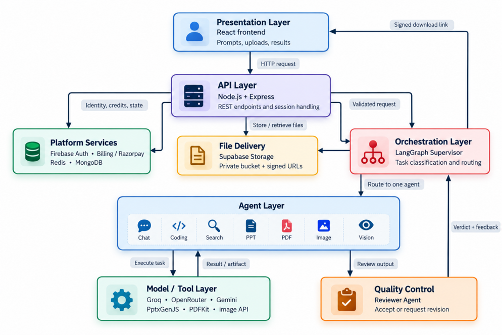

# OrchestrAI

OrchestrAI is a multi-agent AI workspace developed as a Minor Project. It
combines a React frontend with a Node.js microservice backend to provide chat,
coding, search, document generation, image understanding, authentication,
conversation history, file storage, and payments in one platform.

## 1. Why OrchestrAI?

A single general-purpose AI model is not equally effective for every task.
OrchestrAI solves this problem through intelligent routing: a supervisor
identifies the user's intent, delegates the task to a specialized agent, and a
reviewer checks the result before delivery.

## 2. Key features

- Supervisor-led routing with specialized agents for chat, coding, search,
  PDF, PPT, vision, PDF retrieval, and image analysis.
- Reviewer feedback with bounded retries.
- Text and PDF/image upload workflows.
- Persistent conversations and messages.
- Firebase authentication and protected API access.
- Credit plans and Razorpay payment verification.
- MongoDB, Redis, Qdrant, Supabase Storage, and multiple LLM providers.
- Generated PDF/PPT artifacts and controlled download links.

## 3. System architecture



| Layer | Responsibility |
|---|---|
| Presentation | React interface for prompts, uploads, conversations, and results |
| API | Express gateway, authentication, cookies, CORS, and service routing |
| Orchestration | LangGraph supervisor for intent classification and delegation |
| Agents | Task-specific execution for chat, coding, search, PDF, PPT, and vision |
| Models and tools | Groq, Gemini, OpenRouter, Tavily, PDFKit, PptxGenJS, and image APIs |
| Platform services | Firebase, MongoDB, Redis, Razorpay, Qdrant, and Supabase |
| Quality control | Reviewer verdict, feedback, and controlled retry |

### Request flow

```text
User -> React frontend -> API Gateway -> Supervisor
                                      -> Specialist Agent
                                      -> Reviewer
                                      -> Response or signed file link
```

1. The user submits a prompt or file.
2. The gateway validates the request and user session.
3. The supervisor selects one suitable agent.
4. The agent executes the task using its model and tools.
5. The reviewer approves the output or requests a bounded revision.
6. The answer or generated artifact is returned to the frontend.

## 4. Academic project overview

### Problem statement

General-purpose chatbot workflows become difficult to manage when they must
support different tools, domains, file types, and quality requirements.
Without specialization and review, outputs may be less reliable and the
system becomes harder to extend.

### Proposed solution

OrchestrAI implements a modular, supervisor-based multi-agent architecture.
Each agent has a focused responsibility, while shared services manage
identity, persistence, credits, storage, and payments.

### Objectives

- Automate task classification and intelligent agent selection.
- Support both text and multimodal workflows.
- Improve maintainability through independent services and agents.
- Validate generated responses through a reviewer loop.
- Demonstrate practical integration of AI, databases, storage, security, and
  cloud deployment.

### Innovation

The project combines task specialization, provider flexibility, and output
review in one working application. It applies ideas from tool-using agents,
role-based collaboration, and multi-agent evaluation to a full-stack system
rather than a standalone chatbot.

### Functional evaluation

Representative demonstrations in the project presentation showed:

- Chat Agent: conversational response with an approved review verdict.
- Coding Agent: C++ array-reversal artifact with approved review.
- Search Agent: answer with supporting search visuals.
- PDF Agent: Machine Learning guide delivered through a signed download link.

These are functional demonstrations, not claims of universal factual
correctness or production-scale performance.

## 5. Conclusion

OrchestrAI demonstrates a unified and modular AI platform that routes diverse
requests to suitable specialist agents and validates their outputs. The
prototype integrates six primary task capabilities, additional PDF/image
workflows, multiple LLM providers, authentication, billing, persistence,
cloud storage, and microservice APIs.

The project covers the complete engineering cycle: literature-informed
problem formulation, architecture design, implementation, integration, and
functional evaluation. It provides a strong foundation for developing more
reliable, domain-oriented, and scalable multi-agent applications.

## 6. Limitations

- Output quality depends on external model and tool providers.
- Reviewer approval does not guarantee factual correctness.
- Provider rate limits, cost, downtime, and network failures can affect
  execution.
- Large-scale benchmarking, load testing, monitoring, and advanced
  prompt-injection protection need further work.

## 7. Future scope

1. Add long-term memory, planning, and richer agent-to-agent collaboration.
2. Improve routing accuracy, latency, token usage, caching, streaming, and
   provider cost efficiency.
3. Add structured recovery, tracing, audit logs, rate limiting, and stronger
   prompt-injection protection.
4. Create benchmarks for task success, factuality, relevance, latency, cost,
   reviewer agreement, and retry rate.
5. Add Data Analysis, Spreadsheet, Email, research, and database agents.
6. Introduce integration testing, health checks, monitoring, autoscaling, and
   staged CI/CD deployment.

## 8. Project structure

```text
.
├── frontend/                 # React and Vite client
├── backend/
│   ├── gateway/              # Public API gateway
│   ├── services/
│   │   ├── agent/            # LangGraph workflow and AI agents
│   │   ├── auth/             # Authentication and credits
│   │   ├── billing/          # Razorpay integration
│   │   └── chat/             # Conversations and messages
│   ├── shared/redis/         # Shared Redis client
│   └── docker-compose.yml    # Local Redis
├── docs/system-architecture.png
└── README.md
```

## 9. Technology stack

**Frontend:** React 19, Vite, Redux Toolkit, Tailwind CSS, Axios, Firebase,
Monaco Editor, React Markdown.

**Backend:** Node.js, Express, MongoDB/Mongoose, Redis, LangChain, LangGraph,
Groq, Google Gemini, OpenRouter, Tavily, Qdrant, Supabase, Firebase Admin,
Razorpay, Multer, PDFKit, PDF parsing, and PptxGenJS.

## 10. API routes

All service routes are accessed through the gateway.

| Area | Method | Endpoint |
|---|---:|---|
| Gateway | GET | `/` |
| Auth | POST | `/api/auth/login` |
| Auth | GET | `/api/auth/logout` |
| Auth | POST | `/api/auth/update-plan` |
| Auth | POST | `/api/auth/deduct-credits` |
| User | GET | `/api/me` |
| Chat | GET | `/api/chat/create-conversation` |
| Chat | GET | `/api/chat/get-conversations` |
| Chat | POST | `/api/chat/update-conversation` |
| Chat | POST | `/api/chat/save-message` |
| Chat | GET | `/api/chat/get-messages/:conversationId` |
| Agent | POST | `/api/agent/chat` |
| Billing | POST | `/api/billing/create` |
| Billing | POST | `/api/billing/verify` |

Protected routes require the authentication cookie.

## 11. Setup

### Requirements

- Node.js 18+ and npm
- MongoDB and Redis
- Firebase project and Admin SDK service account
- API credentials for the providers you want to use

### Install

```bash
git clone https://github.com/anujmahore/Minor-Project.git
cd Minor-Project

cd frontend && npm install
cd ../backend/gateway && npm install
cd ../services/agent && npm install
cd ../auth && npm install
cd ../billing && npm install
cd ../chat && npm install
```

Start Redis:

```bash
cd backend
docker compose up -d redis
```

### Environment files

Create these local files. Never commit them.

| File | Required variables |
|---|---|
| `backend/gateway/.env` | `PORT`, `FRONTEND_URL`, `AUTH_SERVICE`, `CHAT_SERVICE`, `AGENT_SERVICE`, `BILLING_SERVICE`, `REDIS_URL` |
| `backend/services/auth/.env` | `PORT`, `MONGODB_URI`, `REDIS_URL` |
| `backend/services/chat/.env` | `PORT`, `MONGODB_URI` |
| `backend/services/agent/.env` | `PORT`, `MONGODB_URI`, `REDIS_URL`, `AUTH_SERVICE`, `CHAT_SERVICE`, `GROQ_API_KEY`, `GOOGLE_API_KEY`, `OPENROUTER_API_KEY`, `TAVILY_API_KEY`, `QDRANT_URL`, `QDRANT_API_KEY`, `SUPABASE_URL`, `SUPABASE_SERVICE_ROLE_KEY`, `SUPABASE_BUCKET_NAME`, `MAX_REVIEW_RETRIES` |
| `backend/services/billing/.env` | `PORT`, `MONGODB_URI`, `AUTH_SERVICE`, `RAZORPAY_KEY_ID`, `RAZORPAY_KEY_SECRET` |
| `frontend/.env` | `VITE_SERVER_URL`, `VITE_FIREBASE_API_KEY`, `VITE_RAZORPAY_KEY_ID` |

The auth service also requires the local Firebase Admin file:
`backend/services/auth/serviceAccountKey.json`.

### Run locally

Run each command in a separate terminal:

```bash
cd backend/gateway && npm run dev
cd backend/services/auth && npm run dev
cd backend/services/chat && npm run dev
cd backend/services/agent && npm run dev
cd backend/services/billing && npm run dev
cd frontend && npm run dev
```

The default frontend URL is `http://localhost:5173` and the gateway URL is
`http://localhost:4000`.

## 12. Useful commands

```bash
npm run dev       # Development server
npm start         # Backend production start
npm run build     # Frontend production build
npm run lint      # Frontend linting
```

## 13. Security

- Keep `.env`, Firebase service account files, API keys, payment secrets, and
  uploaded user files out of Git.
- Rotate credentials immediately if they are exposed.
